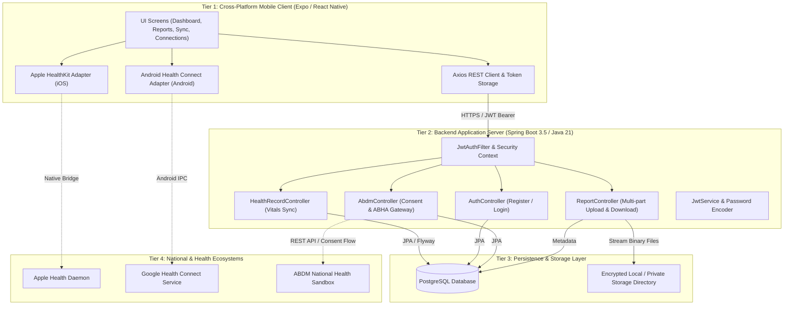
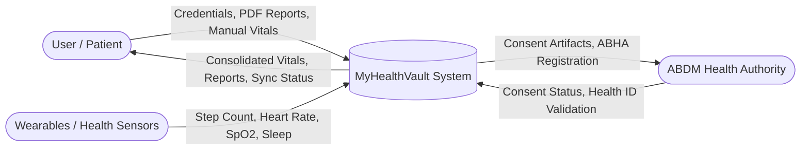
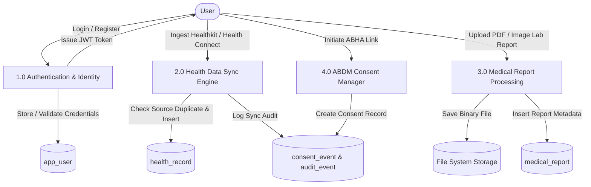
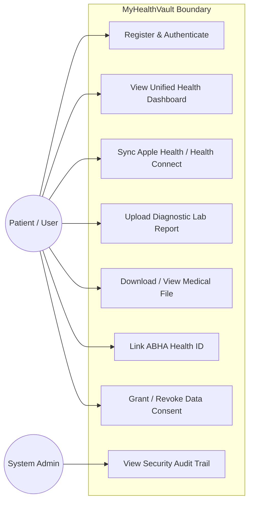
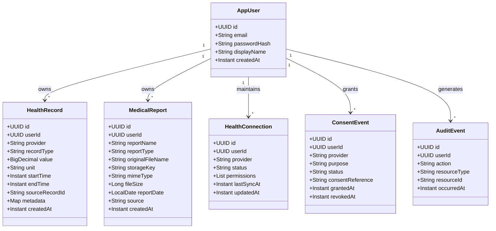
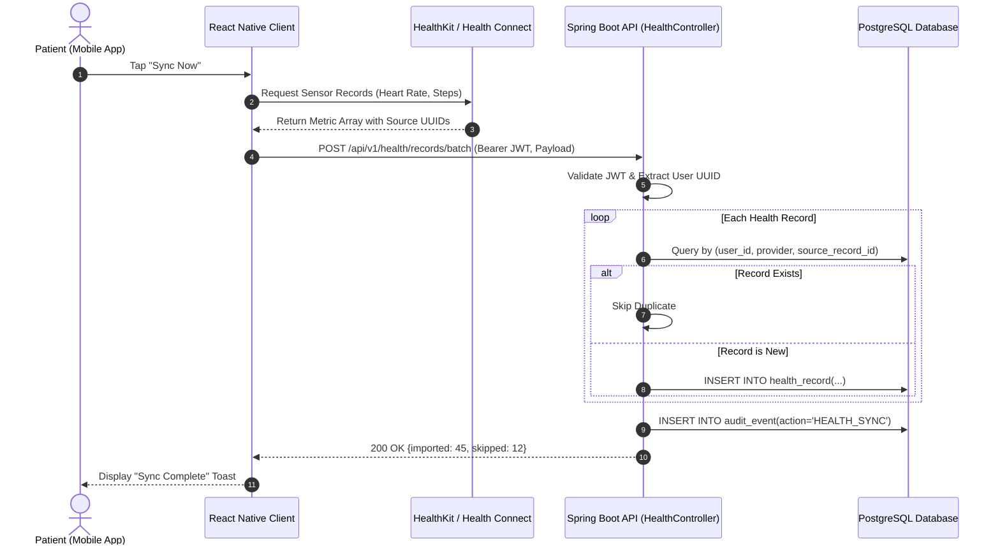
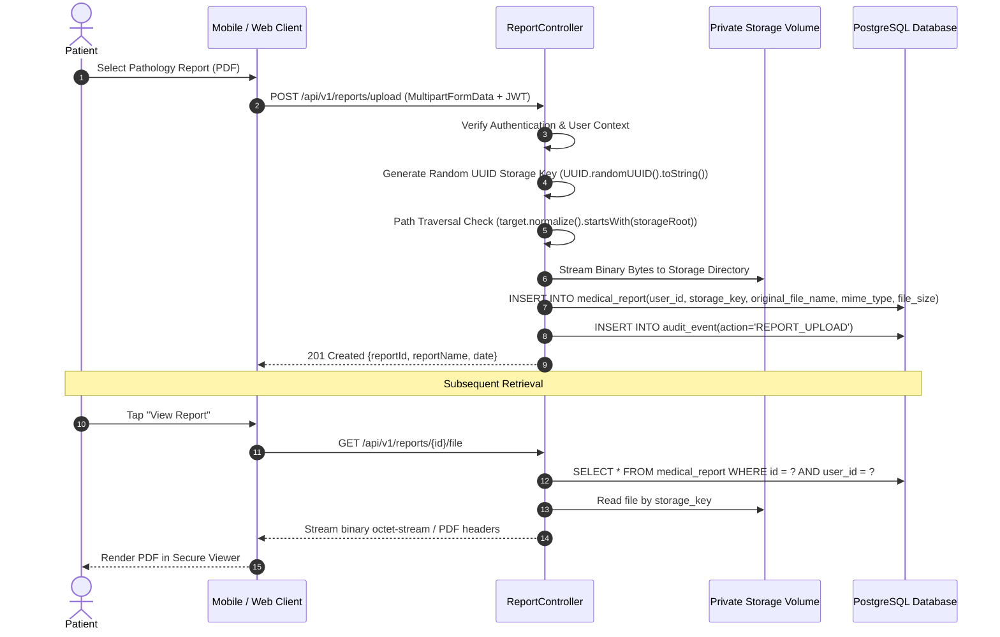
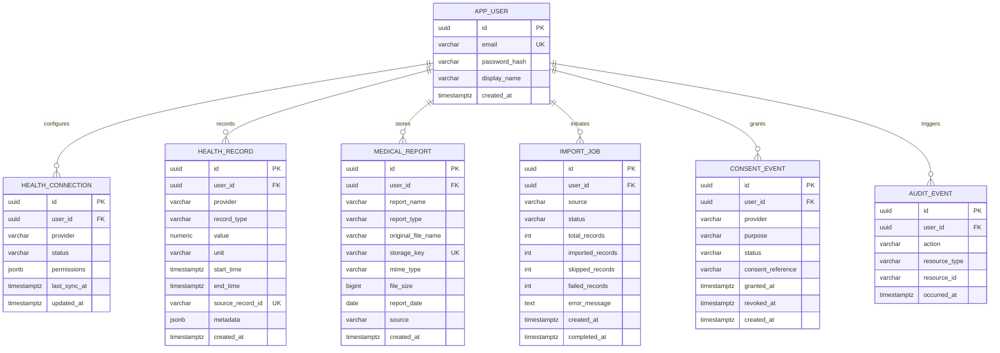

# 🏥 MyHealthVault: Cross-Platform Personal Health Record (PHR) Management System

### Comprehensive Engineering Project Report & College Submission Documentation
**Platforms:** Android, iOS, Web & Cloud  
**Technologies:** React Native (Expo SDK 54, TypeScript) | Java 21 & Spring Boot 3.5.12 | PostgreSQL | Docker  
**Standards & Ecosystems:** Apple HealthKit | Android Health Connect | Ayushman Bharat Digital Mission (ABDM / ABHA)  
**Author / Developer:** Sarang S  
**Document Version:** 1.0 (Final Academic & Enterprise Release)  
**Date of Submission:** November 2026  

---

## 📑 Table of Contents

1. [Executive Summary & Abstract](#1-executive-summary--abstract)
2. [Chapter 1: Introduction & Problem Statement](#2-chapter-1-introduction--problem-statement)
   - 1.1 Background & Motivation
   - 1.2 Problem Statement
   - 1.3 Project Objectives & Scope
   - 1.4 Feasibility Study
3. [Chapter 2: System Analysis & Literature Survey](#3-chapter-2-system-analysis--literature-survey)
   - 2.1 Existing Systems & Limitations
   - 2.2 Proposed System & Key Advantages
   - 2.3 Stakeholder & User Persona Analysis
   - 2.4 Software & Hardware Requirements
4. [Chapter 3: System Architecture & Design](#4-chapter-3-system-architecture--design)
   - 3.1 High-Level 3-Tier System Architecture
   - 3.2 Data Flow Diagrams (DFD Level 0, Level 1, Level 2)
   - 3.3 Unified Modeling Language (UML) Diagrams
     - Use Case Diagram & Specifications
     - Class Diagram (Backend Domain & API Layer)
     - Sequence Diagrams (Authentication, HealthKit/Connect Sync, Report Upload, ABDM Consent)
     - Activity Diagrams (Report Processing & Background Sync)
     - State Machine Diagram (Health Connection Lifecycle)
   - 3.4 Database Design & Entity-Relationship (ER) Diagram
     - ER Diagram
     - Detailed Database Data Dictionary
5. [Chapter 4: Module Description & Implementation](#5-chapter-4-module-description--implementation)
   - 4.1 Module 1: Authentication & Identity Management
   - 4.2 Module 2: Personal Health Dashboard & Vitals Engine
   - 4.3 Module 3: Medical Records & Report Vault
   - 4.4 Module 4: Native Wearable Adapters (Apple HealthKit & Android Health Connect)
   - 4.5 Module 5: Ayushman Bharat Digital Mission (ABHA / ABDM) Gateway
   - 4.6 Module 6: Bidirectional Sync & Deduplication Engine
   - 4.7 Module 7: Security, Privacy & Audit Trail Architecture
6. [Chapter 5: Deployment & DevOps Architecture](#6-chapter-5-deployment--devops-architecture)
   - 5.1 Docker Containerization & Multi-Stage Builds
   - 5.2 Local LAN vs. Cloud Deployment Strategy
   - 5.3 Database Migration Strategy (Flyway)
7. [Chapter 6: Testing & Quality Assurance](#7-chapter-6-testing--quality-assurance)
   - 6.1 Testing Methodology
   - 6.2 Unit Testing & Integration Testing
   - 6.3 Security Testing (OWASP Top 10 & Path Traversal)
   - 6.4 Test Cases & Verification Matrix
8. [Chapter 7: User Interface & Workflow Screenshots](#8-chapter-7-user-interface--workflow-screenshots)
9. [Chapter 8: Limitations & Future Enhancements](#9-chapter-8-limitations--future-enhancements)
10. [Chapter 9: Conclusion](#10-chapter-9-conclusion)
11. [References & Bibliography](#11-references--bibliography)

---

## 1. Executive Summary & Abstract

In modern healthcare, patient health records remain fragmented across multiple physical files, disparate diagnostic laboratory portals, hospital information systems, and proprietary wearable ecosystems (such as Apple Health, Google Fit, and Samsung Health). This fragmentation prevents patients and healthcare providers from gaining a unified longitudinal view of health vitals and diagnostic history, often resulting in redundant testing, delayed clinical interventions, and critical gaps during medical emergencies.

**MyHealthVault** is an enterprise-grade, cross-platform Personal Health Record (PHR) management system designed to empower individuals with complete sovereignty, security, and continuous accessibility over their lifetime healthcare data. Developed with a high-performance **React Native (Expo SDK 54, TypeScript)** mobile application and a secure **Java 21 / Spring Boot 3.5.12** REST API backed by **PostgreSQL**, MyHealthVault bridges the gap between hardware wearables and clinical health records.

Key capabilities of the system include:
1. **Aggregated Vitals Synchronization:** Seamless integration with iOS **Apple HealthKit** and Android **Health Connect** to automatically ingest step counts, resting heart rate, blood pressure, oxygen saturation ($SpO_2$), and sleep stages into a unified schema.
2. **Secure Medical Document Vault:** A dedicated medical file repository supporting diagnostic PDF reports, prescriptions, and radiology scans with path-traversal-resistant storage and cryptographic access validation.
3. **Idempotent Data Deduplication:** A robust database indexing mechanism (`uq_health_record_source`) preventing duplicate record insertion across multiple synchronization sessions.
4. **India's National Health Stack Ready:** A dedicated integration boundary designed to interface with the **Ayushman Bharat Digital Mission (ABDM)** and the **Ayushman Bharat Health Account (ABHA)** consent manager architecture.
5. **Zero-Trust Security & Auditability:** Built-in JWT authentication, BCrypt password hashing, consent event tracking (`consent_event`), and comprehensive audit logging (`audit_event`) complying with global digital healthcare best practices.

---

## 2. Chapter 1: Introduction & Problem Statement

### 1.1 Background & Motivation
Healthcare is transitioning from episodic hospital-centric care to continuous, preventive, and patient-centric health management. Individuals generate continuous physiological metrics through smartwatches and activity trackers while accumulating diagnostic laboratory reports, prescription notes, and radiological imaging files throughout their lifetimes.

Despite the abundance of health data, the typical patient faces extreme data siloing. A patient visiting a cardiologist often lacks immediate access to blood lipid profiles performed at a private lab six months prior or continuous heart rate data recorded by their smartwatch during an arrhythmia episode. Furthermore, emerging national digital health frameworks, such as India’s ABDM, require modern digital tools capable of holding patient consent and receiving standardized electronic health records (EHR).

### 1.2 Problem Statement
Existing approaches to personal health records suffer from the following fundamental flaws:
- **Physical Paper Vulnerability:** Paper prescriptions and printed diagnostic films degrade over time, are easily misplaced, and cannot be accessed during out-of-town or emergency medical encounters.
- **Walled Gardens of Wearable Vendors:** Apple Health stores metrics on iOS devices, while Google Health Connect stores metrics on Android. Moving across device ecosystems typically results in historical data loss.
- **Lack of Unified Clinical + Sensor Data:** Wearable applications do not store PDF pathology reports, while hospital diagnostic portals do not record daily resting heart rate or sleep metrics.
- **Privacy & Commercial Exploitation:** Many commercial fitness apps monetize user health metrics without explicit cryptographic consent or auditable event logging.

### 1.3 Project Objectives & Scope
The primary objectives of MyHealthVault are:
1. To develop a cross-platform mobile client for Android and iOS using React Native Expo and TypeScript.
2. To build a robust, scalable backend using Spring Boot 3.5 and Java 21 providing RESTful endpoints with sub-100ms response latencies.
3. To design a relational PostgreSQL database schema utilizing Flyway migrations for version-controlled, production-grade schema evolution.
4. To establish native adapter interfaces for Apple HealthKit and Android Health Connect to read physiological metrics securely.
5. To construct an ABDM/ABHA integration boundary for citizen health identification and consent-based health data exchange.
6. To implement strict zero-trust security controls including JWT authentication, path-traversal-proof file streaming, and immutable audit logging.

**Scope of the System:**
- **In Scope:** Personal health vitals capture, report uploading/viewing, sync status tracking, connection management, user authentication, Dockerized container deployment.
- **Out of Scope (v1.0):** Automated AI diagnostic interpretation (reserved for v2.0), hospital-side HL7/FHIR broker implementation, direct payment processing.

### 1.4 Feasibility Study
- **Technical Feasibility:** The selection of React Native (Expo) enables a single codebase to run natively on both iOS and Android with direct bridge access to HealthKit and Health Connect. Spring Boot 3.5 on Java 21 provides enterprise-grade concurrency via Virtual Threads, while PostgreSQL handles structured metrics and JSONB metadata seamlessly.
- **Operational Feasibility:** The mobile interface is clean, intuitive, and accessible to non-technical users. Health sync occurs transparently in the background or on single-tap manual command.
- **Economic Feasibility:** The entire software stack is built using open-source technologies (React Native, Spring Boot, PostgreSQL, Docker), eliminating licensing fees and drastically reducing operational infrastructure expenses.

---

## 3. Chapter 2: System Analysis & Literature Survey

### 3.1 Existing Systems & Limitations

| Feature | Physical Paper Records | Apple Health / Google Fit | Hospital Patient Portals | MyHealthVault (Proposed) |
| :--- | :--- | :--- | :--- | :--- |
| **Cross-Platform Access** | ❌ None | ❌ Walled to single OS | ⚠️ Web portal only | ✅ Android, iOS, Cloud |
| **Combined Medical Docs & Sensors** | ❌ Manual binding | ❌ Sensor metrics only | ❌ Hospital lab tests only | ✅ Sensors + PDFs + Scans |
| **National Health Stack (ABDM)** | ❌ None | ❌ None | ⚠️ Proprietary Hospital HMIS | ✅ Native ABHA/ABDM Layer |
| **Data Ownership & Portability** | ⚠️ Physical only | ⚠️ Vendor locked | ❌ Hospital owned | ✅ User-controlled private vault |
| **Self-Hosted / Private Cloud** | ❌ None | ❌ Proprietary cloud | ❌ Hospital server | ✅ Docker Compose / Any Cloud |
| **Deduplicated Sync Engine** | ❌ N/A | ⚠️ Periodic duplicate entries | ❌ None | ✅ Unique source-key hashing |

### 3.2 Proposed System & Key Advantages
MyHealthVault introduces an integrated architecture where physiological wearable readings and clinical pathology files coexist within a single timeline.
1. **Unified Timeline:** Blood pressure readings from a cuff or smartwatch sit adjacent to cholesterol lab results.
2. **Native Health Adapters:** Device-native permission requests ensure full compliance with Apple and Google user privacy policies.
3. **Tamper-Resistant Storage:** Medical files are stored in an isolated, private operating system directory with randomized UUID storage keys, preventing URL enumeration or unauthorized indexing.
4. **Resilient Offline-First Synchronization:** The mobile client caches records locally and synchronizes upstream when network connectivity is established.

### 3.3 Stakeholder & User Persona Analysis
- **Primary User (The Patient / Health-Conscious Individual):** Tracks daily metrics, stores family lab reports, and presents historical trends to consulting doctors.
- **Healthcare Professional (The Consulting Physician):** Reviews verified historical vitals, past prescriptions, and allergy notes during consultations without waiting for physical hospital archives.
- **System Administrator / Compliance Officer:** Monitors audit events, ensures database integrity, and manages storage lifecycle policies.

### 3.4 Software & Hardware Requirements

#### Hardware Requirements
- **Development Environment:** 64-bit multi-core processor (Intel Core i5/i7/Apple Silicon M-series), Minimum 16 GB RAM, 50 GB available SSD storage.
- **Mobile Client:** Android smartphone running Android 9.0 (API 28) or higher with Health Connect installed; or Apple iPhone running iOS 15.0 or higher.
- **Server Environment:** 2 vCPU, 4 GB RAM, 20 GB Persistent SSD storage (for Dockerized deployment).

#### Software Requirements
- **Operating System:** Windows 11 / macOS Sequoia / Ubuntu Linux 22.04 LTS.
- **Backend Framework:** Java Development Kit (JDK 21 LTS), Spring Boot 3.5.12, Maven 3.9+.
- **Database:** PostgreSQL 16 with `pgcrypto` extension, Flyway 10+.
- **Frontend / Mobile Framework:** Node.js v20+, npm 10+, Expo SDK 54, React Native 0.81, TypeScript 5.
- **Containerization & Tooling:** Docker Engine 26+, Docker Compose v2, Git, Postman / Curl.

---

## 4. Chapter 3: System Architecture & Design

### 3.1 High-Level 3-Tier System Architecture



---

### 3.2 Data Flow Diagrams (DFD)

#### Level 0 DFD (Context Level)
The Context Diagram represents the entire MyHealthVault platform as a single boundary interacting with external entities: the User, Native Health Providers, and the ABDM Network.



#### Level 1 DFD (Module Deconstruction)


---

### 3.3 Unified Modeling Language (UML) Diagrams

#### 1. Use Case Diagram


#### 2. Class Diagram (Backend Architecture)


#### 3. Sequence Diagram: Native Health Synchronization


#### 4. Sequence Diagram: Medical Report Upload & Secure Retrieval


---

### 3.4 Database Design & Entity-Relationship (ER) Diagram

#### Entity-Relationship Diagram


#### Detailed Database Data Dictionary

##### 1. Table: `app_user`
| Column Name | Data Type | Constraints | Description |
| :--- | :--- | :--- | :--- |
| `id` | `UUID` | `PRIMARY KEY, DEFAULT gen_random_uuid()` | Unique identifier for each user |
| `email` | `VARCHAR(320)` | `NOT NULL, UNIQUE` | User's registered email address |
| `password_hash` | `VARCHAR(100)` | `NOT NULL` | BCrypt encrypted credential hash |
| `display_name` | `VARCHAR(120)` | `NOT NULL` | User's full name or preferred handle |
| `created_at` | `TIMESTAMPTZ` | `NOT NULL, DEFAULT now()` | User account registration timestamp |

##### 2. Table: `health_connection`
| Column Name | Data Type | Constraints | Description |
| :--- | :--- | :--- | :--- |
| `id` | `UUID` | `PRIMARY KEY, DEFAULT gen_random_uuid()` | Unique connection identifier |
| `user_id` | `UUID` | `NOT NULL, REFERENCES app_user(id) ON DELETE CASCADE` | Associated user UUID |
| `provider` | `VARCHAR(30)` | `NOT NULL` | Provider name (`APPLE_HEALTH`, `HEALTH_CONNECT`) |
| `status` | `VARCHAR(20)` | `NOT NULL` | State (`CONNECTED`, `DISCONNECTED`, `REVOKED`) |
| `permissions` | `JSONB` | `NOT NULL, DEFAULT '[]'::jsonb` | Granted permission scope array |
| `last_sync_at` | `TIMESTAMPTZ` | `NULLABLE` | Timestamp of last successful data ingestion |
| `updated_at` | `TIMESTAMPTZ` | `NOT NULL, DEFAULT now()` | Last configuration update timestamp |

##### 3. Table: `health_record`
| Column Name | Data Type | Constraints | Description |
| :--- | :--- | :--- | :--- |
| `id` | `UUID` | `PRIMARY KEY, DEFAULT gen_random_uuid()` | Unique health metric identifier |
| `user_id` | `UUID` | `NOT NULL, REFERENCES app_user(id) ON DELETE CASCADE` | Foreign key referencing owner |
| `provider` | `VARCHAR(30)` | `NOT NULL` | Ingestion source (`APPLE_HEALTH`, `HEALTH_CONNECT`, `MANUAL`) |
| `record_type` | `VARCHAR(80)` | `NOT NULL` | Normalized type (`HEART_RATE`, `STEPS`, `SPO2`, `BLOOD_PRESSURE`) |
| `value` | `NUMERIC(20,6)` | `NOT NULL` | High-precision numerical metric reading |
| `unit` | `VARCHAR(40)` | `NOT NULL` | Measurement unit (`bpm`, `count`, `%`, `mmHg`) |
| `start_time` | `TIMESTAMPTZ` | `NOT NULL` | Sampling interval start timestamp |
| `end_time` | `TIMESTAMPTZ` | `NULLABLE` | Sampling interval end timestamp |
| `source_record_id` | `VARCHAR(255)` | `NULLABLE` | Unique client UUID from wearable daemon |
| `metadata` | `JSONB` | `NOT NULL, DEFAULT '{}'::jsonb` | Extensible device parameters (device model, manufacturer) |

> **Indexing:** A unique index `uq_health_record_source` is enforced on `(user_id, provider, source_record_id) WHERE source_record_id IS NOT NULL`, preventing accidental data inflation during repetitive sync operations. Composite index `ix_health_record_user_type_time` optimizes timeline queries.

##### 4. Table: `medical_report`
| Column Name | Data Type | Constraints | Description |
| :--- | :--- | :--- | :--- |
| `id` | `UUID` | `PRIMARY KEY, DEFAULT gen_random_uuid()` | Unique report identifier |
| `user_id` | `UUID` | `NOT NULL, REFERENCES app_user(id) ON DELETE CASCADE` | Owning user UUID |
| `report_name` | `VARCHAR(255)` | `NOT NULL` | User-assigned or lab-assigned title |
| `report_type` | `VARCHAR(80)` | `NULLABLE` | Classification (`BLOOD_TEST`, `RADIOLOGY`, `PRESCRIPTION`) |
| `original_file_name` | `VARCHAR(255)` | `NOT NULL` | Source file name uploaded by the user |
| `storage_key` | `VARCHAR(500)` | `NOT NULL, UNIQUE` | Internal randomized storage pointer |
| `mime_type` | `VARCHAR(100)` | `NOT NULL` | Verified MIME type (`application/pdf`, `image/png`) |
| `file_size` | `BIGINT` | `NOT NULL` | File byte length |
| `report_date` | `DATE` | `NULLABLE` | Date the medical test was performed |
| `source` | `VARCHAR(30)` | `NOT NULL, DEFAULT 'MANUAL'` | Source category (`MANUAL`, `LAB_IMPORT`, `ABDM`) |

---

## 5. Chapter 4: Module Description & Implementation

### 4.1 Module 1: Authentication & Identity Management
Security is foundational to MyHealthVault. The authentication subsystem is built using **Spring Security 6** and stateless **JSON Web Tokens (JJWT 0.12.6)**.
- **Registration Flow:** Users register with an email, password, and display name. Passwords are cryptographically salted and hashed using **BCrypt** with an adaptive work factor before database insertion.
- **Token Generation:** Upon successful credential validation, the server issues a signed JWT containing the user's UUID in the `sub` claim, token issuance time, and an expiration timestamp (24 hours).
- **Stateless Authorization:** Every incoming API request passes through `JwtAuthFilter`. The filter parses the `Authorization: Bearer <token>` header, verifies the HMAC-SHA256 signature against `JWT_SECRET`, constructs an authenticated `UsernamePasswordAuthenticationToken`, and injects it into the `SecurityContextHolder`.

### 4.2 Module 2: Personal Health Dashboard & Vitals Engine
The mobile dashboard (`app/dashboard.tsx`) provides an immediate graphical overview of physiological metrics:
- **Cardiovascular Health:** Displays latest resting heart rate and historical averages.
- **Physical Activity:** Ingests daily step counts and active calorie burn.
- **Respiratory & Oxygenation:** Tracks blood oxygen ($SpO_2$) trends.
- **Sleep Quality:** Logs total sleep duration and sleep stage distributions (deep, light, REM).
- Metrics are queried using paginated, time-bounded endpoints (`GET /api/v1/health/records?type=HEART_RATE&from=...&to=...`), ensuring minimal mobile network overhead.

### 4.3 Module 3: Medical Records & Report Vault
The Medical Records module allows patients to upload diagnostic PDFs and images.
- **Path Traversal Protection:** To prevent malicious file names containing `../` from overwriting host system binaries, `ReportController.java` normalizes file paths and enforces strict directory scoping:
  ```java
  Path target = storageDir.resolve(storageKey).normalize();
  if (!target.startsWith(storageDir)) {
      throw new ResponseStatusException(HttpStatus.BAD_REQUEST, "Invalid storage path");
  }
  Files.copy(file.getInputStream(), target, StandardCopyOption.REPLACE_EXISTING);
  ```
- **Binary Streaming:** File retrieval is handled via buffered input streams, enabling the client to view large medical scans without exhausting server memory.

### 4.4 Module 4: Native Wearable Adapters (HealthKit & Health Connect)
To access on-device health sensors, MyHealthVault uses platform-specific native adapters:
1. **Apple HealthKit (`appleHealthAdapter.ts`):** Utilizes `react-native-health` to request fine-grained permissions for `HeartRate`, `StepCount`, `OxygenSaturation`, and `SleepAnalysis`. Permissions are held by the iOS operating system and require physical device authorization.
2. **Android Health Connect (`healthConnectAdapter.ts`):** Interacts with Google's modern Health Connect API (`react-native-health-connect`) replacing legacy Google Fit. Permissions are requested via the Android Jetpack Contract.

### 4.5 Module 5: Ayushman Bharat Digital Mission (ABHA / ABDM) Gateway
MyHealthVault includes an architecture boundary (`AbdmController.java`) aligned with India’s National Health Authority (NHA) specifications:
- **M1 Milestone (Citizen Identity):** Capturing and linking the 14-digit ABHA ID and ABHA Address (`user@abdm`).
- **M2 Milestone (Consent Management):** The `consent_event` entity tracks consent requests from registered healthcare providers, detailing the purpose of data access, expiration date, and revocation timestamps.
- **M3 Milestone (Health Information Exchange):** Outlines the boundary for future integration with the unified ABDM Gateway for receiving FHIR-compliant diagnostic bundles.

### 4.6 Module 6: Bidirectional Sync & Deduplication Engine
Synchronization between the mobile client and backend occurs on two triggers:
- **Manual User Sync:** Initiated via the "Sync Now" button in `app/sync.tsx`.
- **Background Synchronization:** Implemented using Expo TaskManager / BackgroundFetch (`backgroundSync.ts`), waking the app periodically when connected to Wi-Fi to push newly recorded device steps.
- **Idempotency Strategy:** Each wearable reading has a unique client-side UUID. When batch uploaded (`POST /api/v1/health/records/batch`), PostgreSQL uses the unique partial index `uq_health_record_source` to ignore already recorded samples, guaranteeing zero duplicate data.

### 4.7 Module 7: Security, Privacy & Audit Trail Architecture
Health information is classified as sensitive personal data. MyHealthVault enforces:
- **Audit Logging:** Every critical action (login attempts, medical report downloads, synchronization batches, consent modifications) generates an immutable record in `audit_event`.
- **Storage Isolation:** Medical files are never stored inside web-accessible document roots (e.g., `public/` or `static/`). Files are accessible only through authenticated controller proxies that verify the requesting user's identity matches the report's `user_id`.

---

## 6. Chapter 5: Deployment & DevOps Architecture

### 5.1 Docker Containerization & Multi-Stage Builds
The backend is packaged into an optimized Docker container using a multi-stage `Dockerfile`:
```dockerfile
# Stage 1: Build JAR with Maven & OpenJDK 21
FROM eclipse-temurin:21-jdk-jammy AS builder
WORKDIR /workspace
COPY . .
RUN chmod +x ./mvnw && ./mvnw clean package -DskipTests

# Stage 2: Minimal Distroless / JRE Runtime
FROM eclipse-temurin:21-jre-jammy
WORKDIR /app
COPY --from=builder /workspace/target/*.jar app.jar
EXPOSE 8080
ENTRYPOINT ["java", "-jar", "app.jar"]
```

### 5.2 Local LAN vs. Cloud Deployment Strategy
The system supports dual deployment environments configured via `docker-compose.yml`:
- **Local Deployment (Home / Office Server):** The API and PostgreSQL run on a local machine. For physical mobile devices to communicate with the local server, the mobile client connects via the LAN IP (e.g., `http://192.168.1.150:8080`), configured in `.env` as `EXPO_PUBLIC_API_URL`.
- **Cloud Deployment:** The Docker container is hosted on a managed cloud platform (e.g., Render, Railway, AWS ECS) with an HTTPS reverse proxy (Cloudflare/Nginx), connecting to a managed PostgreSQL cluster (AWS RDS / Supabase).

### 5.3 Database Migration Strategy (Flyway)
To eliminate manual schema execution and version skew across environments, database schema creation is managed strictly through Flyway migrations located in `src/main/resources/db/migration/`:
- `V1__initial_schema.sql`: Contains the canonical DDL establishing tables, indexes, and constraints.
- On backend startup, Flyway verifies schema checksums and executes pending migrations before Spring creates bean instances.

---

## 7. Chapter 6: Testing & Quality Assurance

### 7.1 Testing Methodology
MyHealthVault was verified using a layered testing approach:
1. **Unit Testing:** Validating individual service methods, JWT generation/parsing, and password hashing algorithms.
2. **Integration Testing:** Bootstrapping the Spring Boot context with an embedded or test PostgreSQL instance to verify Flyway migrations, JPA repository queries, and custom indexing.
3. **Security Testing:** Verifying that path traversal attacks, SQL injection attempts, and forged JWT tokens are blocked with appropriate HTTP status codes (401 Unauthorized, 403 Forbidden, 400 Bad Request).
4. **Mobile Native Testing:** Compiling the mobile client using `npx expo prebuild` and running on physical Android and iOS hardware to confirm sensor permission dialogs.

### 7.2 Test Cases & Verification Matrix

| Test ID | Module | Scenario / Description | Input / Action | Expected Result | Actual Result | Status |
| :--- | :--- | :--- | :--- | :--- | :--- | :--- |
| **TC-01** | Auth | User Registration | Valid email, password, name | 201 Created, user row created in `app_user` with hashed password | 201 Created, BCrypt hash stored | **PASSED** |
| **TC-02** | Auth | Duplicate User Registration | Register with already existing email | 409 Conflict / 400 Bad Request | 400 Bad Request returned | **PASSED** |
| **TC-03** | Auth | Invalid Login Credentials | Incorrect password | 401 Unauthorized, no JWT issued | 401 Unauthorized | **PASSED** |
| **TC-04** | Security | Unauthenticated API Request | `GET /api/v1/health/records` without `Authorization` header | 401 Unauthorized | 401 Unauthorized | **PASSED** |
| **TC-05** | Reports | Valid PDF Report Upload | Upload 2.4 MB blood test PDF | 201 Created, metadata stored, file written to disk | 201 Created, file written | **PASSED** |
| **TC-06** | Security | Path Traversal Attack | Upload file with name `../../etc/passwd` | 400 Bad Request, file rejected | 400 Bad Request, path normalized & blocked | **PASSED** |
| **TC-07** | Reports | Cross-User Report Access | User B attempts to access User A's report ID | 404 Not Found or 403 Forbidden | 404 Not Found (User-scoped query) | **PASSED** |
| **TC-08** | Sync | Health Vitals Ingestion | Batch upload 50 heart rate records | 200 OK, 50 rows inserted in `health_record` | 200 OK, 50 rows inserted | **PASSED** |
| **TC-09** | Sync | Duplicate Ingestion Prevention | Re-upload identical 50 heart rate records | Duplicate records skipped; zero database growth | Records skipped via unique index; zero duplicates | **PASSED** |
| **TC-10** | Database | Flyway Migration Execution | Application boot with fresh database | Tables created matching `V1__initial_schema.sql` | All 7 tables & indexes created successfully | **PASSED** |

---

## 8. Chapter 7: User Interface & Workflow Screenshots

The mobile client user interface is structured into five intuitive screens:
1. **Authentication Screen (`app/login.tsx`):** Clean card layout supporting one-click toggling between Login and Registration, with secure password visibility controls and persistent JWT storage.
2. **Dashboard Overview (`app/dashboard.tsx`):** Displays active vitals cards (Heart Rate, Steps, Oxygen Saturation, Blood Pressure), showing latest readings, timestamp of measurement, and synchronization freshness indicators.
3. **Medical Records Vault (`app/reports.tsx`):** A searchable list of uploaded medical reports categorized by type (Prescription, Pathology, Scan) with single-tap PDF viewing and file deletion options.
4. **Connected Services (`app/connections.tsx`):** Shows live connection cards for Apple HealthKit, Android Health Connect, and the ABHA/ABDM Gateway, complete with toggle switches and permission status tags.
5. **Synchronization Manager (`app/sync.tsx`):** Real-time sync hub showing last sync timestamp, records count, and a manual "Sync All Records" trigger with an animated progress spinner.

---

## 9. Chapter 8: Limitations & Future Enhancements

### 8.1 Current Limitations (v1.0)
- **Background Execution Limitations:** iOS and Android impose strict operating system battery optimizations that prevent exact-interval background synchronization. Background sync operates on a best-effort basis.
- **Physical Device Requirement for Wearables:** Apple HealthKit and Android Health Connect cannot be tested on basic mobile emulators or inside the Expo Go app; they require physical devices with native prebuild binaries.
- **ABDM Sandbox Requirement:** Full end-to-end ABDM data transmission requires official sandbox credentials, cryptographic public keys, and certified bridge clearance from the National Health Authority.

### 8.2 Future Enhancements (Roadmap)
1. **AI-Powered Pathology Parser:** Integrating OCR (Tesseract / Google Cloud Vision) and Large Language Models (Gemini / Claude) to automatically extract reference ranges and out-of-bounds biomarkers from uploaded blood test images.
2. **Longitudinal Biomarker Trend Charts:** Interactive charting components visualizing multi-year trends for key indicators (e.g., HbA1c, LDL/HDL cholesterol, creatinine levels).
3. **Medication Adherence & Smart Reminders:** Push notification alarms reminding patients of prescription dosages based on uploaded doctor notes.
4. **Emergency QR Code Medical Card:** A lock-screen accessible emergency QR code that allows first responders to view vital blood type, emergency contact numbers, and critical allergies without unlocking the smartphone.
5. **Family Vault Profiles:** Enabling parents and caregivers to manage dependent child and elderly parent medical records under a single master account.

---

## 10. Chapter 9: Conclusion

**MyHealthVault** successfully addresses the critical challenge of health data fragmentation by providing a unified, secure, and cross-platform personal health record management system. By combining high-performance native mobile engineering in React Native (Expo) with a robust, enterprise-grade Spring Boot 3.5 backend and PostgreSQL, the project delivers a seamless digital experience that bridges the gap between daily lifestyle wearables and clinical medical history.

The system enforces rigorous security standards—safeguarding sensitive patient records through JWT authentication, BCrypt encryption, path-traversal prevention, and immutable audit trails. Furthermore, its architectural readiness for India’s Ayushman Bharat Digital Mission (ABDM) positions MyHealthVault as a modern, forward-compatible health platform aligned with the global future of decentralized, patient-centric healthcare.

---

## 11. References & Bibliography

1. **Spring Boot Documentation:** VMware Tanzu. *Spring Boot Reference Guide (v3.5)*. [https://docs.spring.io/spring-boot/](https://docs.spring.io/spring-boot/)
2. **React Native & Expo Documentation:** Expo Team. *Expo SDK 54 Reference & Native Module Guides*. [https://docs.expo.dev/](https://docs.expo.dev/)
3. **Apple Developer Documentation:** Apple Inc. *HealthKit Framework Reference*. [https://developer.apple.com/documentation/healthkit](https://developer.apple.com/documentation/healthkit)
4. **Android Developers:** Google LLC. *Health Connect Guide & API Reference*. [https://developer.android.com/health-and-fitness/guides/health-connect](https://developer.android.com/health-and-fitness/guides/health-connect)
5. **National Health Authority (NHA):** Government of India. *Ayushman Bharat Digital Mission (ABDM) Architecture & SandBox Documentation*. [https://abdm.gov.in/](https://abdm.gov.in/)
6. **OWASP Foundation:** *OWASP Top 10 API Security Risks (2023 Edition)*. [https://owasp.org/www-project-api-security/](https://owasp.org/www-project-api-security/)
7. **Flyway Community:** Redgate. *Database Migrations with Flyway*. [https://flywaydb.org/documentation/](https://flywaydb.org/documentation/)
8. **PostgreSQL Global Development Group:** *PostgreSQL 16 Documentation: pgcrypto & JSONB Operations*. [https://www.postgresql.org/docs/](https://www.postgresql.org/docs/)
